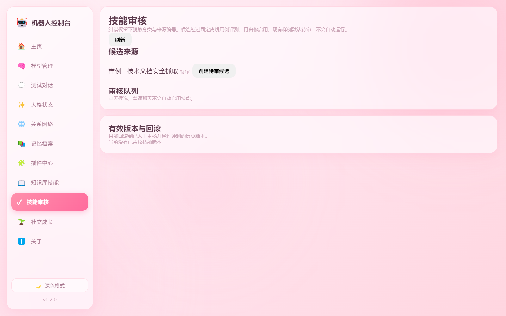
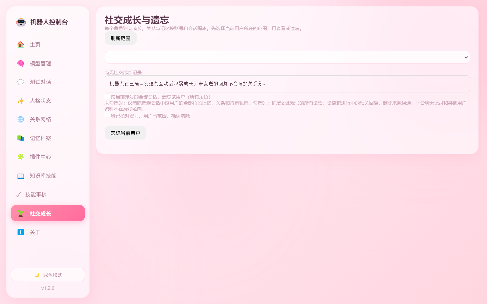

# 实施与独立验收记录

日期：2026-10-30。开发基线：28c882ec。使用便携 Node 18.20.8，固定微信/Frida环境未改。

## 全量离线门禁

`runtime/node18/node.exe scripts/verify-all.mjs`：100个JavaScript源码语法检查通过；14套行为测试113/113，通过回复清洗28/28、群触发20/20及模拟Electron IPC。共9道门禁通过，无失败、取消或跳过。

测试使用临时数据根、合成配置与模拟模型/网络，不读取生产记忆、不修改生产配置与停用开关、不启动真实平台服务。旧测试入口的回归映射见TESTING.md。

## 独立验收/debug

单独的acceptance_debug子代理进行独立审查，最初发现以下九项边缘缺陷；每项均新增可运行复现，修复后9/9通过，并再次运行完整门禁。

1. 迁移源文件unlink失败后丢失清理来源：改为持久化可重试意图。
2. 先遗忘再首次迁移会复活数据：迁移尊重持久主体删除标记。
3. 轨迹unlink错误被吞：继续处理其他对象并明确返回AggregateError。
4. 候选或评测部分删除失败后无法重试：保留匿名清理意图与来源，删除不受UI显示数量限制。
5. 控制台跨进程遗忘未即时清除outbox归因：同锁清理与差量合并，旧缓存保存不能恢复归因。
6. 改一个迁移角色会丢其他会话角色：逐项覆盖冻结映射，显式恢复默认在重启后仍有效。
7. 可选量词正则阻塞事件循环：编译前限制小方言的量词与捕获分组。
8. 本地模型默认跟随重定向：显式拒绝重定向，环回推理不能转发到公网。
9. 额度预留后、关联outbox前崩溃留下无主hold：恢复时释放无来源占位，未知发送仍保守处理。

主代理另补充跨进程遗忘后的内存历史失效、极端角色基线缓慢变化、诊断模式不学习、对象原型角色拒绝及模糊alternation正则反例。

整合后的最终抽查再次分出独立子代理，复现并修复两项并发/中断遗漏：旧任务在遗忘后写回纠错轨迹，以及迁移主清单提交前已写备份却失去清理来源。轨迹、候选、评测发布与遗忘现共用持久写锁，锁内重新校验原始删除代际；异步评测不跨await持锁，发布前重读候选与来源。迁移先持久化可追溯意图，再复制备份。遗忘也会清理崩溃遗留的原子写临时文件，已审批抽象模板去除私人候选链接。

对应新增9项永久回归，最终验收子代理重新独立执行全量门禁，113/113通过。

## 打包验收

Electron 33.4.11 / electron-builder 25.1.8 构建独立Windows目录包；使用已安装的Electron，不更新生产运行环境。51份包内源码与6份控制台资源逐一核对；最终包在主目录源码上重建并做字节哈希比对。

最终包检查还发现旧的renderer通配符误收开发辅助目录`.mimosa`。已改为实际界面文件白名单，并排除运行资源中的隐藏文件和目录；重新构建后核对包内完整文件清单，不携带开发会话元数据。

隐藏隔离GUI成功加载包内skills/social服务、拒绝进程控制、切换至技能审核、社交成长两个页面并输出离屏截图（两页均exit 0）。隔离配置强制位于新临时目录，不会使用BOT_CONFIG_FILE指向的现有配置。控制台IPC回归另验证主frame/窗口来源、完整scope、人工审批和停用。

## 未验证与限制

真实微信/Frida收发、Ollama语言质量与延迟、第三方在线服务未测试，也未计入通过。既有运行进程与旧控制台包不自动重启或替换。用户正常重启后才执行真实账号的首次迁移。

JSON journal适合首轮单机规模，历史增长时成本线性上升。自动技能候选为有限模板，不训练模型权重或自动改代码。旧无来源日志、项目外自行备份不承诺逐人精确删除。

## 界面记录

